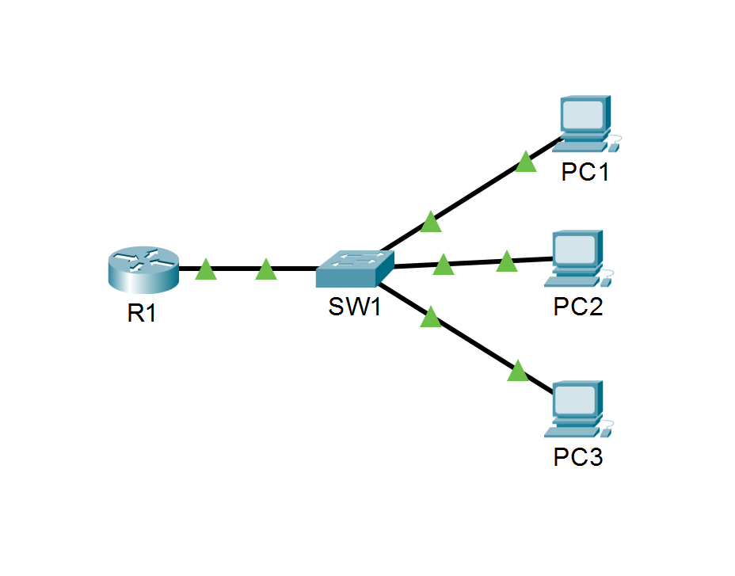
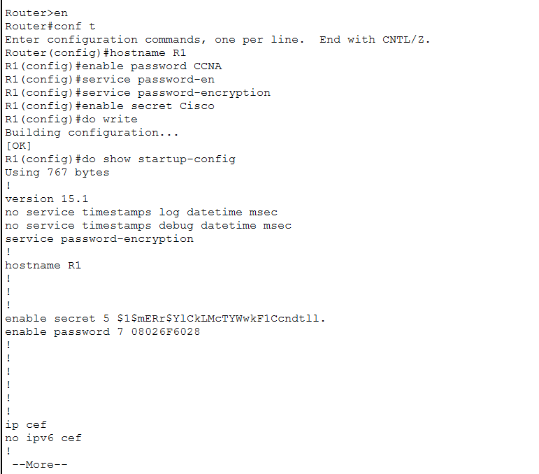

# Lab 01: Cisco IOS CLI Basics

## Objective
Configure initial device settings and password encryption on Cisco IOS devices (`R1` and `SW1`), and save the running configuration to NVRAM.

## Lab Topology


## Key Configurations Applied
```text
enable
configure terminal
hostname R1
enable password CCNA
service password-encryption
enable secret Cisco
do write
```
## Verification
Verified password encryption (Type 5 MD5 for `enable secret` and Type 7 for `enable password`) and NVRAM configuration persistence using `show startup-config`.



## Lab File
* [Download Packet Tracer File (`CLI-Basics.pkt`)](./CLI-Basics.pkt)