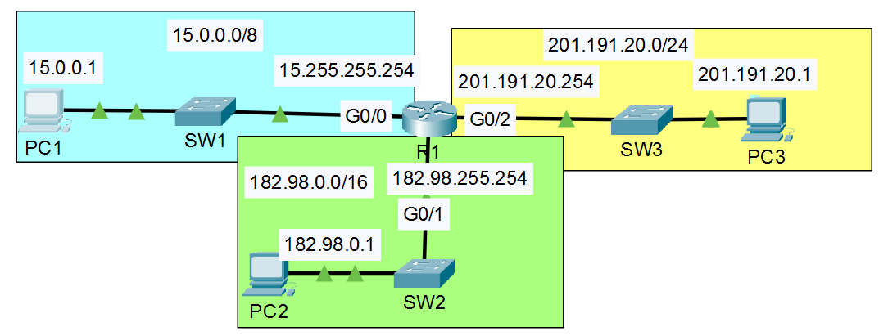
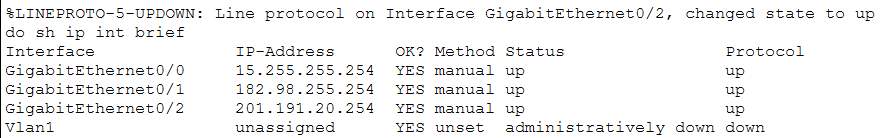
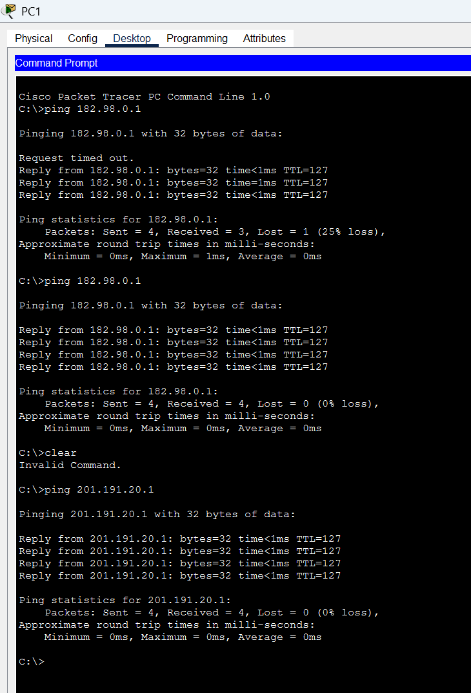

# Lab 02: IPv4 Addressing

## Objective
Configure IPv4 addresses, subnet masks, and interface descriptions on `R1`, enable the router interfaces, and verify end-to-end connectivity across networks.

## Lab Topology


## Key Configurations Applied
```text
enable
configure terminal
interface g0/0
ip address 15.255.255.254 255.0.0.0
description connect to SW1
no shut
interface g0/1
ip address 182.98.255.254 255.255.0.0
description connect to SW2
no shut
interface g0/2     
ip address 201.191.20.254 255.255.255.0
description connect to SW3
no shut
end
write 
```

## Verification
Verified router interface IP assignments and `up / up` states using `show ip interface brief` on `R1`, and confirmed inter-network connectivity using `ping` from `PC1`.





## Lab File
* [Download Packet Tracer File (`Router-IPv4-Configuration.pkt`)](./Router-IPv4-Configuration.pkt)