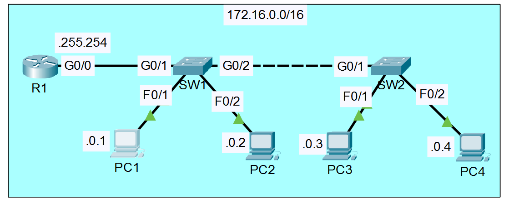
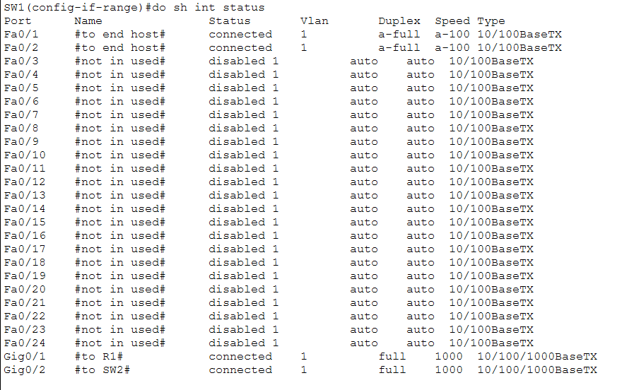
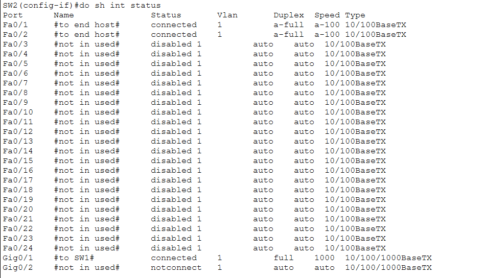

# Lab 03: Switch & Router Interface Configuration

## Objective
Configure interface descriptions, speed, and duplex settings on `SW1`, `SW2`, and `R1`, administratively disable unused ports using interface ranges, and verify interface states with `show interfaces status`.

## Lab Topology


## Key Configurations Applied
```text
! SW1 Configuration
en
conf t
int range f0/1-2
desc #to end host#
int range f0/3-24
desc #not in used#
shut
int g0/1
desc #to R1#
speed 1000
duplex full
int g0/2
desc #to SW2#
speed 1000
duplex full
do wr

! SW2 Configuration
en
conf t
int range f0/1-2
desc #to end host#
int range f0/3-24
desc #not in used#
shut
int g0/1
desc #to SW1#
speed 1000
duplex full
int g0/2
desc #not in used#
shut
do wr

! R1 Configuration
en
conf t
int g0/0
desc #to SW1#
speed 1000
duplex full
no shut
do wr
```

## Verification
Verified port descriptions, `connected` vs. `disabled` interface states, and speed/duplex settings on `SW1` and `SW2` using `show interfaces status`.





## Lab File
* [Download Packet Tracer File (`Interface-Configuration.pkt`)](./Interface-Configuration.pkt)