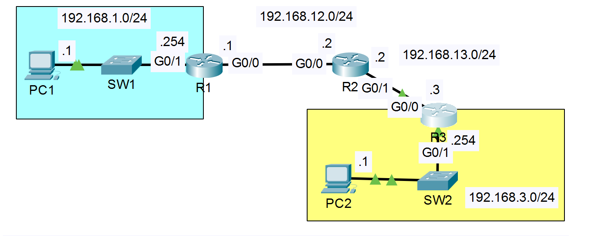
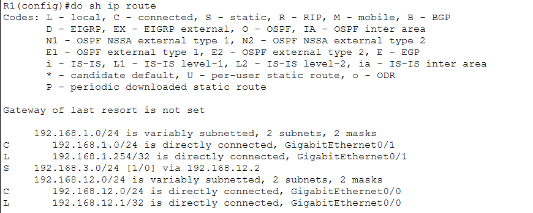
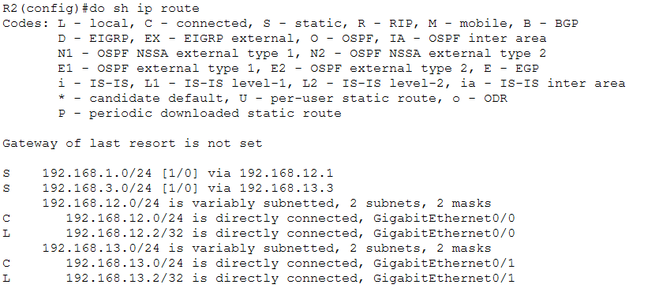
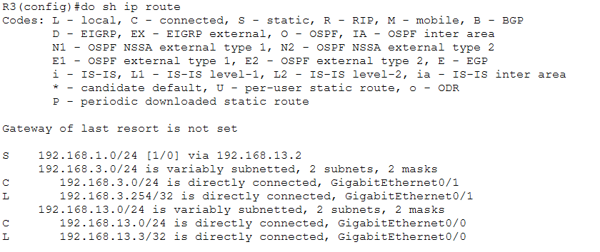
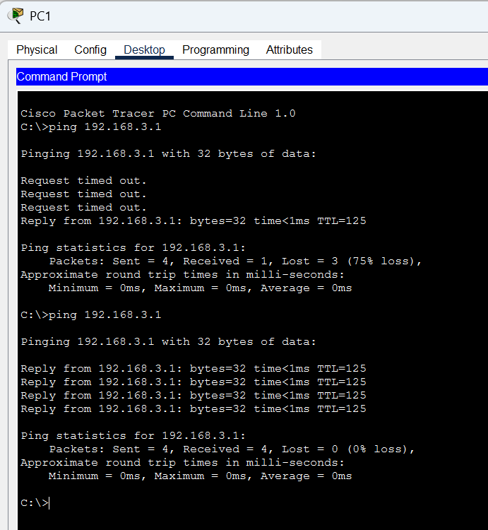

# Lab 04: Static Routing

## Objective
Configure IPv4 addressing and manual static routes across `R1`, `R2`, and `R3` to establish end-to-end Layer 3 reachability between `PC1` and `PC2`, and verify routing tables with `show ip route`.

## Lab Topology


## Key Configurations Applied
```text
! R1 Configuration
en
conf t
hostname R1
int g0/1
ip add 192.168.1.254 255.255.255.0
no shut
int g0/0
ip add 192.168.12.1 255.255.255.0
no shut
ex
ip route 192.168.3.0 255.255.255.0 192.168.12.2
do wr

! R2 Configuration
en
conf t
hostname R2
int g0/0
ip add 192.168.12.2 255.255.255.0
no shut
int g0/1
ip add 192.168.13.2 255.255.255.0
no shut
ex
ip route 192.168.1.0 255.255.255.0 192.168.12.1
ip route 192.168.3.0 255.255.255.0 192.168.13.3
do wr

! R3 Configuration
en
conf t
hostname R3
int g0/0
ip add 192.168.13.3 255.255.255.0
no shut
int g0/1
ip add 192.168.3.254 255.255.255.0
no shut
ex
ip route 192.168.1.0 255.255.255.0 192.168.13.2
do wr
```

## Verification
Verified connected (`C`), local (`L`), and static (`S`) route entries on `R1`, `R2`, and `R3` using `show ip route`, and confirmed end-to-end reachability by pinging `PC2` from `PC1`.









## Lab File
* [Download Packet Tracer File (`Configuring Static-Routes.pkt`)](./Configuring%20Static-Routes.pkt)