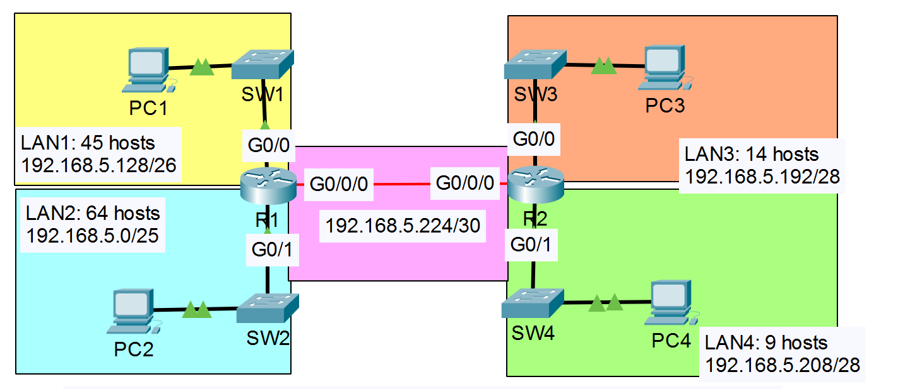
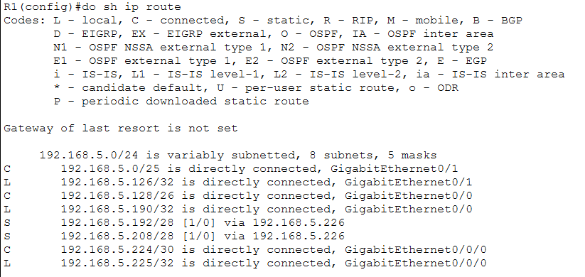
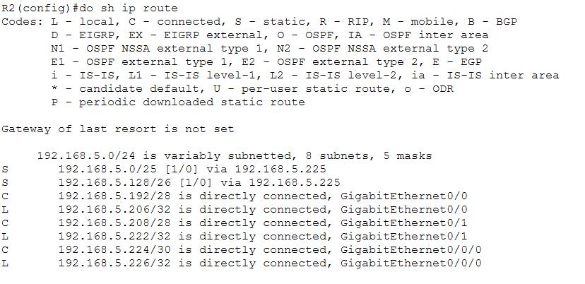
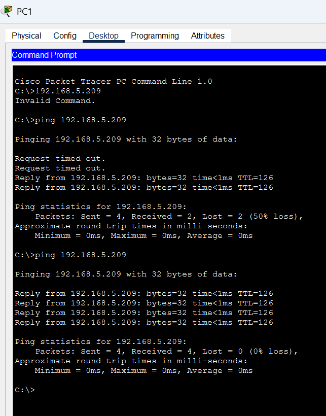

# Lab 05: Subnetting & VLSM

## Objective
Subnet the `192.168.5.0/24` network using Variable Length Subnet Masking (VLSM) to efficiently accommodate four LANs (`64`, `45`, `14`, and `9` hosts) plus a point-to-point router link, assign the first usable address to each PC and the last usable address to each LAN gateway interface, configure static routes between `R1` and `R2`, and verify end-to-end reachability.

## Lab Topology


| Segment | Hosts Required | Subnet / CIDR | Subnet Mask | PC IP (First Usable) | Router Gateway (Last Usable) |
| :--- | :--- | :--- | :--- | :--- | :--- |
| **LAN2 (`R1 g0/1`)** | 64 | `192.168.5.0/25` | `255.255.255.128` | `192.168.5.1` | `192.168.5.126` |
| **LAN1 (`R1 g0/0`)** | 45 | `192.168.5.128/26` | `255.255.255.192` | `192.168.5.129` | `192.168.5.190` |
| **LAN3 (`R2 g0/0`)** | 14 | `192.168.5.192/28` | `255.255.255.240` | `192.168.5.193` | `192.168.5.206` |
| **LAN4 (`R2 g0/1`)** | 9 | `192.168.5.208/28` | `255.255.255.240` | `192.168.5.209` | `192.168.5.222` |
| **R1–R2 Link (`g0/0/0`)** | 2 | `192.168.5.224/30` | `255.255.255.252` | — | `R1: .225` / `R2: .226` |

## Key Configurations Applied
```text
! R1 Configuration
en
conf t
int g0/0
ip add 192.168.5.190 255.255.255.192
no shut
int g0/1
ip add 192.168.5.126 255.255.255.128
no shut
int g0/0/0
ip add 192.168.5.225 255.255.255.252
no shut
ex
ip route 192.168.5.192 255.255.255.240 192.168.5.226
ip route 192.168.5.208 255.255.255.240 192.168.5.226
do wr

! R2 Configuration
en
conf t
int g0/0
ip add 192.168.5.206 255.255.255.240
no shut
int g0/1
ip add 192.168.5.222 255.255.255.240
no shut
int g0/0/0
ip add 192.168.5.226 255.255.255.252
no shut
ex
ip route 192.168.5.0 255.255.255.128 192.168.5.225
ip route 192.168.5.128 255.255.255.192 192.168.5.225
do wr
```

## Verification
Verified connected (`C`), local (`L`), and static (`S`) VLSM routes on `R1` and `R2` using `show ip route`, and confirmed end-to-end connectivity across all subnets by pinging remote hosts from `PC1`.







## Lab File
* [Download Packet Tracer File (`Subnetting & VLSM.pkt`)](./Subnetting%20&%20VLSM.pkt)