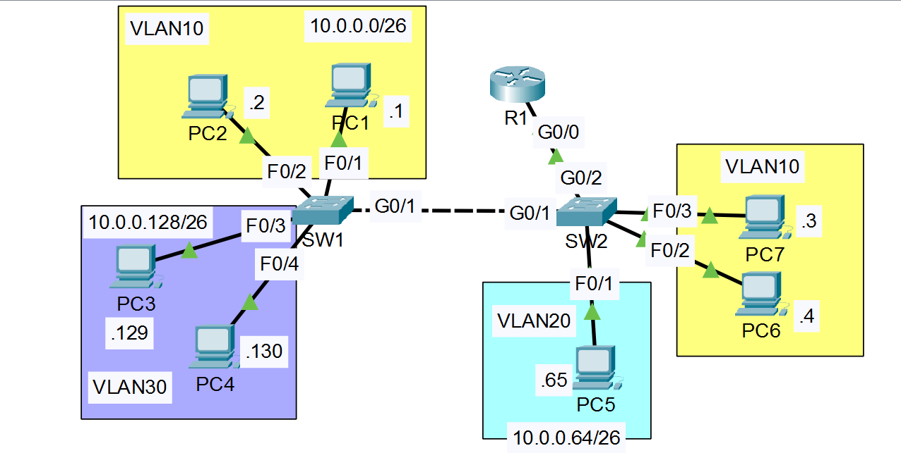
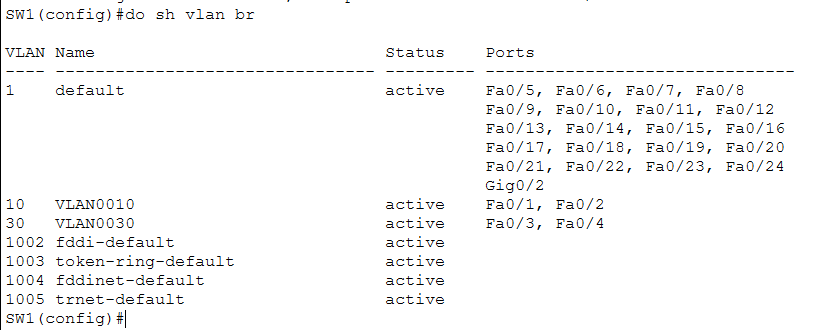
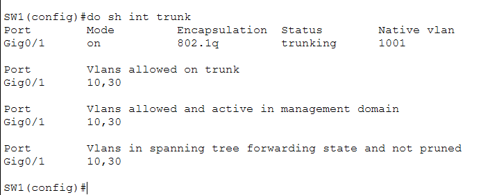
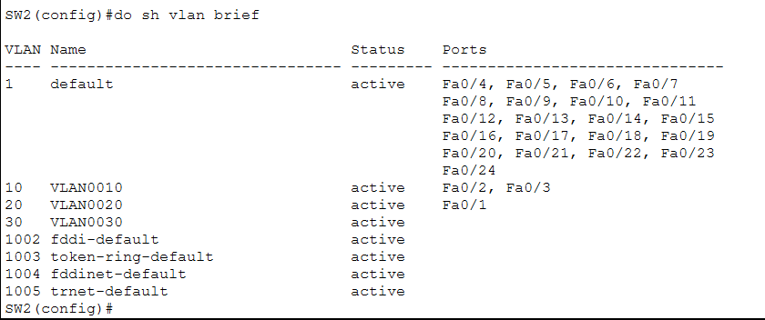
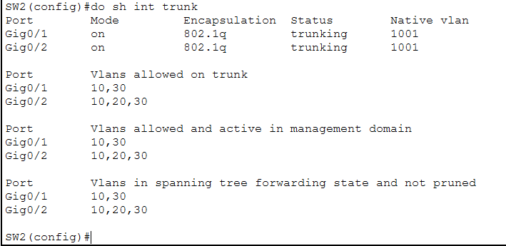
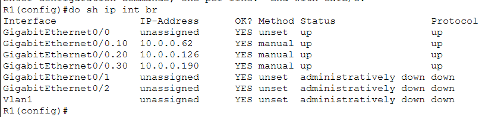
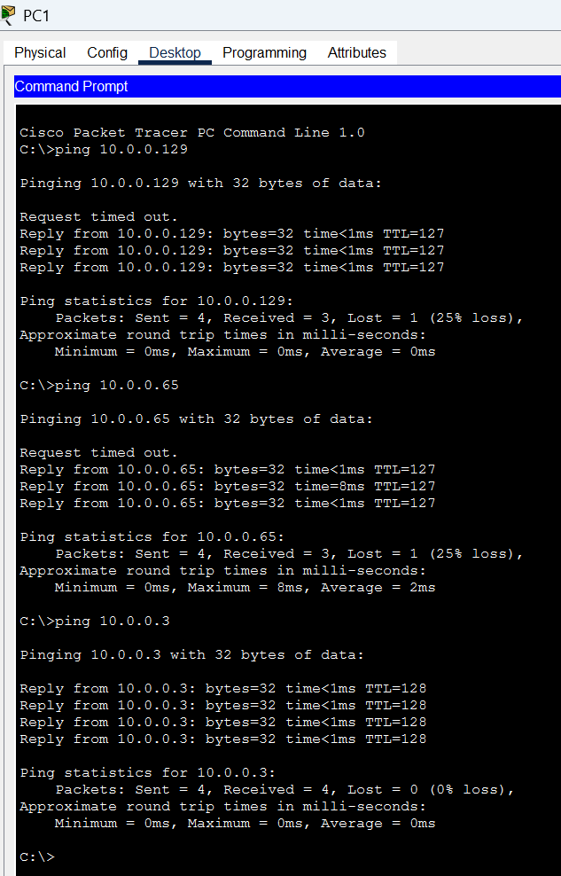

# Lab 06: VLANs, Trunking & Router-on-a-Stick (ROAS)

## Objective
Segment the network into VLANs `10`, `20`, and `30` across `SW1` and `SW2`, configure 802.1Q trunk links with native VLAN `1001` and allowed VLAN pruning, implement Router-on-a-Stick (`ROAS`) subinterfaces on `R1` for inter-VLAN routing, and verify Layer 2 and Layer 3 connectivity across all segments.

## Lab Topology


| VLAN | Subnet / CIDR | Subnet Mask | Default Gateway (`R1`) | Switch Access Ports | Host IPs |
| :--- | :--- | :--- | :--- | :--- | :--- |
| **VLAN 10** | `10.0.0.0/26` | `255.255.255.192` | `10.0.0.62` (`G0/0.10`) | `SW1: F0/1–2`, `SW2: F0/2–3` | `PC1: .1`, `PC2: .2`, `PC7: .3`, `PC6: .4` |
| **VLAN 20** | `10.0.0.64/26` | `255.255.255.192` | `10.0.0.126` (`G0/0.20`) | `SW2: F0/1` | `PC5: .65` |
| **VLAN 30** | `10.0.0.128/26` | `255.255.255.192` | `10.0.0.190` (`G0/0.30`) | `SW1: F0/3–4` | `PC3: .129`, `PC4: .130` |

## Key Configurations Applied
```text
! SW1 Configuration
en
conf t
int range f0/1-2
sw mo ac
sw ac vlan 10
int range f0/3-4
sw mo ac
sw ac vlan 30
int g0/1
sw mo tr
sw tr na vlan 1001
sw tr al vlan 10,30
do wr

! SW2 Configuration
en
conf t
vlan 30
ex
int f0/1
sw mo ac
sw ac vlan 20
int range f0/2-3
sw mo ac
sw ac vlan 10
int g0/1
sw mo tr
sw tr na vlan 1001
sw tr al vlan 10,30
int g0/2
sw mo tr
sw tr na vlan 1001
sw tr al vlan 10,20,30
do wr

! R1 Configuration
en
conf t
int g0/0
no shut
int g0/0.10
enc dot1q 10
ip add 10.0.0.62 255.255.255.192
int g0/0.20
enc dot1q 20
ip add 10.0.0.126 255.255.255.192
int g0/0.30
enc dot1q 30
ip add 10.0.0.190 255.255.255.192
do wr
```

## Verification
Verified VLAN port assignments with `show vlan brief`, 802.1Q trunking, native VLAN `1001`, and allowed VLAN lists with `show interfaces trunk`, Router-on-a-Stick subinterface states on `R1` with `show ip interface brief`, and inter-VLAN connectivity from `PC1`.













## Lab File
* [Download Packet Tracer File (`VLANs (Part 1).pkt`)](./VLANs-(Part-1).pkt)