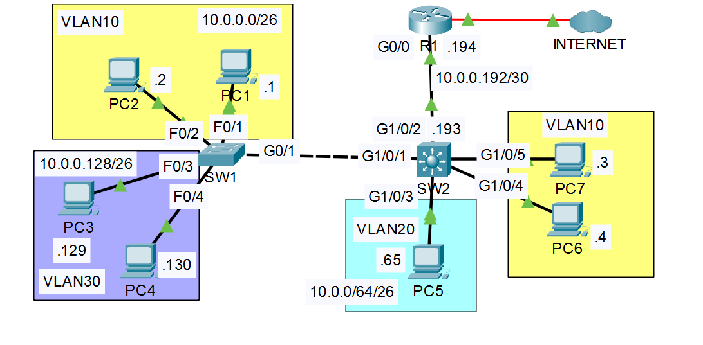
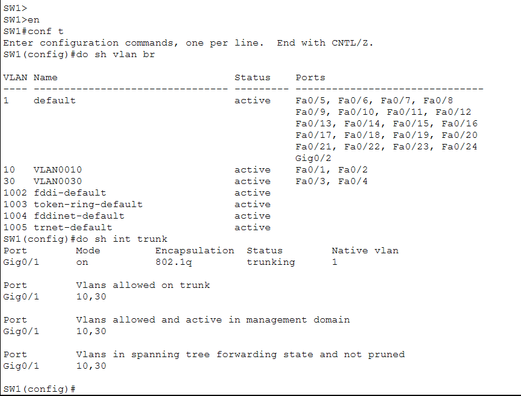
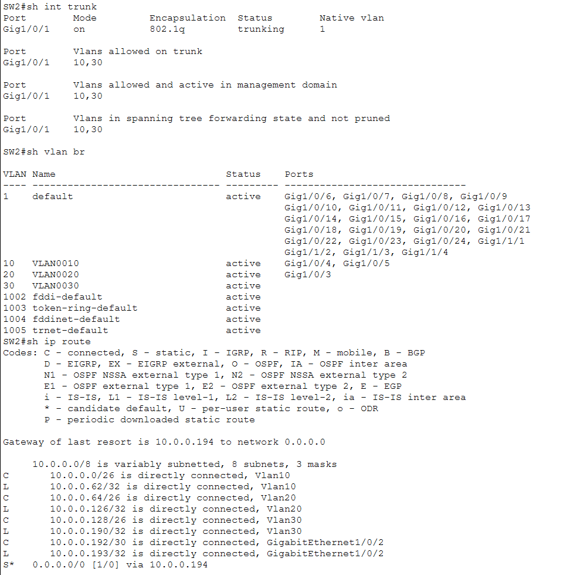
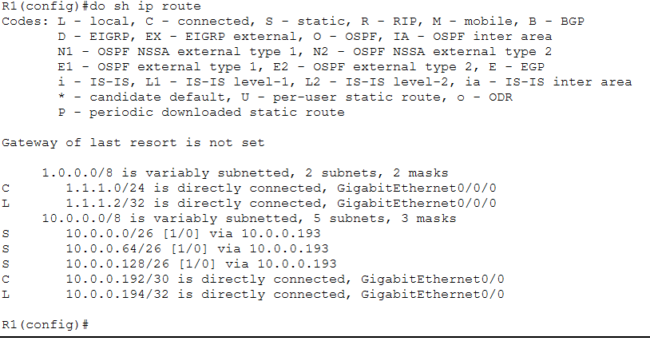
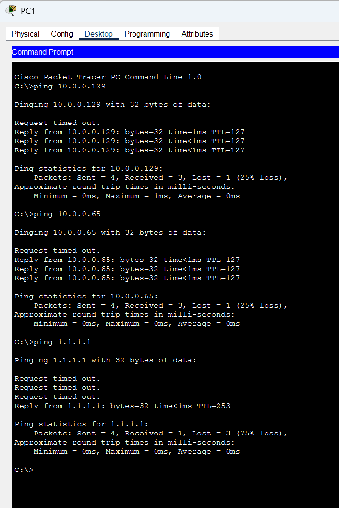

# Lab 07: Layer 3 Switch Inter-VLAN Routing

## Objective
Configure inter-VLAN routing on a Layer 3 multilayer switch (`SW2`) using Switch Virtual Interfaces (`SVIs`) for VLANs `10`, `20`, and `30`, enable IP routing, convert the uplink to `R1` into a Layer 3 routed port (`10.0.0.192/30`), configure default and static return routes for external reachability, and verify end-to-end connectivity across all VLANs and to `1.1.1.1`.

## Lab Topology


| Segment / Link | Subnet / CIDR | Subnet Mask | Gateway / L3 Interface | Switch Access Ports | Host IPs |
| :--- | :--- | :--- | :--- | :--- | :--- |
| **VLAN 10** | `10.0.0.0/26` | `255.255.255.192` | `10.0.0.62` (`SW2 Vlan10`) | `SW1: F0/1–2`, `SW2: G1/0/4–5` | `PC1: .1`, `PC2: .2`, `PC7: .3`, `PC6: .4` |
| **VLAN 20** | `10.0.0.64/26` | `255.255.255.192` | `10.0.0.126` (`SW2 Vlan20`) | `SW2: G1/0/3` | `PC5: .65` |
| **VLAN 30** | `10.0.0.128/26` | `255.255.255.192` | `10.0.0.190` (`SW2 Vlan30`) | `SW1: F0/3–4` | `PC3: .129`, `PC4: .130` |
| **SW2–R1 Routed Link** | `10.0.0.192/30` | `255.255.255.252` | `SW2 G1/0/2: .193` / `R1 G0/0: .194` | — | — |

## Key Configurations Applied
```text
! SW1 Configuration
en
conf t
int range f0/1-2
sw mo acc
sw acc vlan 10
int range f0/3-4
sw mo acc
sw acc vlan 30
int g0/1
sw mo tr
sw tr al vlan 10,30
do wr

! SW2 Configuration (Multilayer Switch)
en
conf t
ip routing
vlan 30
ex
int g1/0/3
sw mo acc
sw acc vlan 20
int range g1/0/4-5
sw mo acc
sw acc vlan 10
int g1/0/1
sw tr enc dot1q
sw mo tr
sw tr al vlan 10,30
int g1/0/2
no sw
ip add 10.0.0.193 255.255.255.252
int vlan 10
ip add 10.0.0.62 255.255.255.192
int vlan 20
ip add 10.0.0.126 255.255.255.192
int vlan 30
ip add 10.0.0.190 255.255.255.192
ex
ip route 0.0.0.0 0.0.0.0 10.0.0.194
do wr

! R1 Configuration
en
conf t
int g0/0
ip add 10.0.0.194 255.255.255.252
no shut
ex
ip route 10.0.0.0 255.255.255.192 10.0.0.193
ip route 10.0.0.64 255.255.255.192 10.0.0.193
ip route 10.0.0.128 255.255.255.192 10.0.0.193
do wr
```

## Verification
Verified VLAN assignments and 802.1Q trunking on `SW1` and `SW2` with `show vlan brief` and `show interfaces trunk`, confirmed active SVIs, Layer 3 routed port addressing, default routing, and static return routes on `SW2` and `R1` with `show ip route`, and validated inter-VLAN and external (`1.1.1.1`) reachability from `PC1`.









## Lab File
* [Download Packet Tracer File (`Multi Layer Switching.pkt`)](./Multi-Layer-Switching.pkt)